 

 

 

 

 

`team@github ~ $ ./links.sh`

[BONDUP](https://play.google.com/store/apps/details?id=com.bondupmvs.com) · [Portfolio](https://www.profile.teampk.site) · [LinkedIn](https://www.linkedin.com/in/pannawit-krutnak-9728562a8/) · [Email](mailto:amteamxmail@gmail.com) · [GitHub](https://github.com/AmTeamX)

